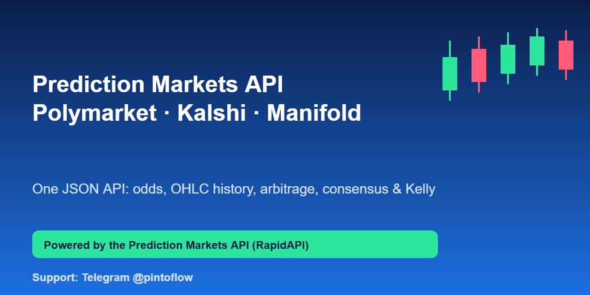
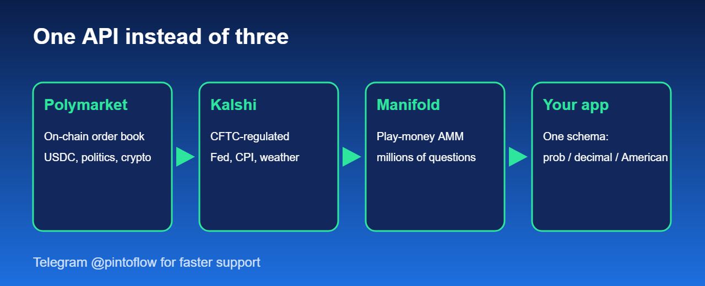

<p align="center"></p>

<p align="center">
<a href="https://rapidapi.com/belchiorarkad-FqvHs2EDOtP/api/prediction-markets"><b>Get your API key on RapidAPI</b></a> ·
<a href="https://t.me/pintoflow">Telegram @pintoflow</a> ·
<a href="#example-projects">Example projects</a>
</p>

> **Free plan available.** Subscribe on RapidAPI: [https://rapidapi.com/belchiorarkad-FqvHs2EDOtP/api/prediction-markets](https://rapidapi.com/belchiorarkad-FqvHs2EDOtP/api/prediction-markets)



## Example projects

Open-source projects built on this API (MIT):

| Project | What it does |
|---|---|
| [polymarket-kalshi-arbitrage-scanner](https://github.com/BelNaruto/polymarket-kalshi-arbitrage-scanner) | Python CLI that finds cross-venue and dutch-book arbitrage, fee-aware, with watch mode |
| [prediction-market-telegram-bot](https://github.com/BelNaruto/prediction-market-telegram-bot) | Zero-dependency Node.js Telegram bot: odds, fair value, arbitrage alerts, Kelly sizing |
| [prediction-markets-odds-dashboard](https://github.com/BelNaruto/prediction-markets-odds-dashboard) | Web dashboard comparing venues with consensus gauge and 30-day price charts |

---

# Prediction Markets API — Polymarket, Kalshi & Manifold Odds, Arbitrage, Consensus & Kelly

> ## ⚡ Need a FASTER reply? Contact support on Telegram: **[@pintoflow](https://t.me/pintoflow)**
> Questions, bugs, custom endpoints, higher limits or feature requests — message **Telegram @pintoflow** and you will get the quickest response. RapidAPI messages are answered more slowly.

---

## What is the Prediction Markets API?

**Prediction Markets API** is a real-time REST API that gives you **normalized prediction market data** from the three biggest venues — **Polymarket**, **Kalshi** and **Manifold** — in **one consistent JSON shape**.

Instead of integrating three different APIs with three different schemas, authentication methods, price formats and rate limits, you call one API and get: live markets, live odds (probability, decimal and American), order books, OHLC price history, cross-venue arbitrage scans, same-venue "dutch book" mispricing scans, a volume-weighted consensus (fair value) probability, and a Kelly-criterion stake calculator.

No signup on the underlying venues, no API keys to manage for them, no stale data: **every response is computed live when you call it.**

**Perfect for:** prediction market dashboards, trading bots, arbitrage scanners, odds comparison sites, election and event forecasting tools, news and media widgets, quant research, backtesting, Discord/Telegram bots, and AI agents that need real-world probabilities.

---

## Data Sources (Where the data comes from)

All data is fetched live from the public market data of each venue and normalized into a single schema.

| Source | `venue` value | What it is | What you get through this API |
|---|---|---|---|
| **Polymarket** | `polymarket` | The world's largest crypto-settled prediction market (on-chain order book, USDC). Huge coverage of politics, elections, crypto, sports, geopolitics, culture and economics. | Markets, events, live bid/ask, order book, OHLC history, multi-outcome events (dutch-book scan) |
| **Kalshi** | `kalshi` | The first CFTC-regulated US prediction market exchange. Event contracts on Fed rates, inflation, weather, elections, economics, sports and more. | Markets, events, tickers, live bid/ask, order book, OHLC history, fee-aware edge calculation |
| **Manifold** | `manifold` | Community play-money forecasting platform with an AMM (automated market maker). Millions of user-created questions on almost any topic. | Markets, probabilities, liquidity pool, reconstructed price history |

**Why three venues?** Prices for the *same question* often differ between Polymarket, Kalshi and Manifold. That gap is exactly what the arbitrage, consensus and odds-comparison endpoints are built to surface.

---

## Key Features

- **One schema for three venues** — Polymarket, Kalshi and Manifold, same JSON fields everywhere
- **Live odds in 3 formats** — implied probability, decimal odds and American odds on every outcome
- **Markets & search** — list and full-text search markets across all venues in one call
- **Order books** — live bids/asks (Manifold returns AMM pool probability and liquidity)
- **OHLC price history** — candles from `1m` to `1w`, lookback up to `365d`
- **Cross-venue arbitrage scanner** — finds the same question priced differently on two venues, with optional Kalshi fee modeling (`feeAware`)
- **Same-venue dutch book scanner** — checks whether the Yes prices of a multi-candidate event sum to less than $1 (no fuzzy title matching)
- **Consensus / fair value** — volume-weighted probability across venues, plus a disagreement score
- **Kelly criterion calculator** — stake sizing from your own probability estimate and live market price
- **Resilient** — if one venue is down you still get the others, plus a `warnings` array

---

## Base URL & Authentication

On RapidAPI, send every request to the host shown on your subscription's **Endpoints** tab, with the standard RapidAPI headers:

```bash
curl --request GET \
  --url 'https://YOUR-RAPIDAPI-HOST/api/health' \
  --header 'x-rapidapi-host: YOUR-RAPIDAPI-HOST' \
  --header 'x-rapidapi-key: YOUR-RAPIDAPI-KEY'
```

Every example below shows only the path and query string — prefix it with your host and attach the two headers above. There is no separate API key for this service itself; your RapidAPI key is all you need.

---

## Response Format

Every response, success or failure, uses the same three-field envelope:

```json
{ "error": false, "data": { "...": "the actual payload" }, "message": "OK" }
```

```json
{ "error": true, "data": null, "message": "Kalshi market not found: NOPE-99" }
```

- **`error`** — always a boolean. `false` means the call succeeded; check this field, not the HTTP status code, if you only want one thing to branch on.
- **`data`** — the payload on success, `null` on failure. Shaped differently per endpoint (documented below) — never a mix of a payload and an error.
- **`message`** — `"OK"` on success, or a human-readable description of what went wrong on failure.

The JSON examples under each endpoint below show only the **`data`** value, for brevity — in the real response it's always wrapped in the envelope above.

---

## Quick Start

**1. List the biggest active markets right now, across all three venues:**

```bash
GET /api/markets?limit=10
```

**2. Get everything about one market (Polymarket, by slug):**

```bash
GET /api/markets/polymarket/will-there-be-a-government-shutdown-in-2026
```

**3. Compare odds for the same topic across venues:**

```bash
GET /api/odds?q=fed%20rate%20cut
```

**4. Get hourly price history for the last 7 days:**

```bash
GET /api/history/kalshi/KXHIGHNY-26OCT27-T67?interval=1h&lookback=7d
```

**5. Scan for cross-venue mispricing:**

```bash
GET /api/arbitrage?q=mamdani&minEdge=0.02
```

**6. Find a riskless mispricing within one multi-candidate event (same venue, no fuzzy matching involved):**

```bash
GET /api/arbitrage/events?q=prime%20minister%20of%20israel
```

**7. Get a volume-weighted "fair value" probability across venues for one question:**

```bash
GET /api/consensus?q=government%20shutdown
```

**8. Size a bet with the Kelly criterion from your own probability estimate:**

```bash
GET /api/kelly?probability=0.65&venue=kalshi&id=KXHIGHNY-26OCT27-T67&bankroll=500&fraction=0.5
```

---

## Supported Venues

| Venue | `venue` value | Notes |
|---|---|---|
| Polymarket | `polymarket` | Crypto-settled, on-chain order book |
| Kalshi | `kalshi` | CFTC-regulated US exchange |
| Manifold | `manifold` | Play-money forecasting community; AMM-priced, no order book |

Most endpoints take a `venue` path segment or query parameter using these exact lowercase values.

---

## Endpoints

### `GET /api/health`
Liveness check.

```bash
GET /api/health
```
```json
{ "status": "ok", "time": "2026-10-26T19:05:56.599Z", "venues": ["polymarket", "kalshi", "manifold"] }
```

### `GET /api/venues`
Lists the prediction market venues this API covers.

---

### `GET /api/markets`
Normalized market listing. Omit `venue` to merge results from all three.

| Param | Type | Default | Notes |
|---|---|---|---|
| `venue` | string | all venues | `polymarket` \| `kalshi` \| `manifold` |
| `q` | string | — | filters by title (see **Search notes** below) |
| `limit` | number | `20` | max `200`. Applied **per venue** when `venue` is omitted |

```bash
GET /api/markets?venue=polymarket&limit=5
GET /api/markets?q=bitcoin&limit=10
```

Response:
```json
{
  "count": 2,
  "markets": [
    {
      "venue": "polymarket",
      "id": "2589812",
      "ticker": "will-there-be-no-change-in-fed-interest-rates-after-the-october-2026-meeting",
      "title": "Will there be no change in Fed interest rates after the October 2026 meeting?",
      "url": "https://polymarket.com/market/...",
      "category": "fomc",
      "status": "open",
      "closeTime": "2026-10-29T03:59:00Z",
      "volume": 23357574.46,
      "liquidity": 267606.65,
      "bestBid": 0.92,
      "bestAsk": 0.921,
      "outcomes": [
        { "name": "Yes", "odds": { "probability": 0.9205, "decimal": 1.086, "american": -1158 }, "bid": 0.92, "ask": 0.921 },
        { "name": "No",  "odds": { "probability": 0.0795, "decimal": 12.579, "american": 1158 }, "bid": 0.079, "ask": 0.08 }
      ]
    }
  ],
  "warnings": null
}
```

If one venue fails to respond, you still get results from the others, plus a `warnings` array describing what failed — the request never fails as a whole just because one upstream venue is down.

### `GET /api/markets/{venue}/{id}`
A single normalized market. `{id}` accepts whatever identifier that venue natively uses:

| Venue | Accepted `{id}` |
|---|---|
| `polymarket` | numeric market id **or** slug |
| `kalshi` | market ticker (e.g. `KXHIGHNY-26OCT27-T67`) |
| `manifold` | market id **or** slug |

```bash
GET /api/markets/kalshi/KXELONMARS-99
GET /api/markets/manifold/will-lula-finish-his-fourth-term-as
```

### `GET /api/markets/{venue}/{id}/orderbook`
Live order book. For Manifold (which has no order book — it trades against an AMM pool) this instead returns the current probability and liquidity pool with an explanatory `note`.

```bash
GET /api/markets/polymarket/will-kylian-mbapp-win-the-2026-ballon-dor/orderbook?outcome=Yes
GET /api/markets/kalshi/KXELONMARS-99/orderbook
```

```json
{
  "venue": "kalshi",
  "ticker": "KXELONMARS-99",
  "bids": [{ "price": 0.08, "size": 1540.73 }, { "price": 0.07, "size": 2236.48 }],
  "asks": [{ "price": 0.11, "size": 73.59 }, { "price": 0.12, "size": 28.6 }]
}
```

---

### `GET /api/odds/{venue}/{id}`
Just the outcomes and odds for one market, in three formats: implied probability, decimal, and American.

```bash
GET /api/odds/polymarket/will-kylian-mbapp-win-the-2026-ballon-dor
```

### `GET /api/odds?q={term}`
Side-by-side odds for a topic across every venue in one call — the fastest way to eyeball a line shop.

```bash
GET /api/odds?q=fed%20rate
```

---

### `GET /api/history/{venue}/{id}`
Normalized OHLC candles for one market outcome.

| Param | Type | Default | Allowed values |
|---|---|---|---|
| `interval` | string | `1h` | `1m`, `5m`, `15m`, `1h`, `4h`, `1d`, `1w` |
| `lookback` | string | `7d` | `1d`, `7d`, `30d`, `90d`, `180d`, `365d` |
| `outcome` | string | `Yes` | `Yes` or `No` (Polymarket also accepts custom outcome names) |

```bash
GET /api/history/kalshi/KXHIGHNY-26OCT27-T67?interval=1d&lookback=30d
GET /api/history/polymarket/will-kylian-mbapp-win-the-2026-ballon-dor?interval=4h&lookback=90d
GET /api/history/manifold/ssSLULNsnE?interval=1h&lookback=7d
```

```json
{
  "venue": "kalshi",
  "ticker": "KXHIGHNY-26OCT27-T67",
  "outcome": "Yes",
  "interval": "1d",
  "lookback": "30d",
  "candles": [
    { "t": 1790467200000, "time": "2026-09-27T00:00:00.000Z", "o": 0.11, "h": 0.11, "l": 0.09, "c": 0.09, "v": 295 }
  ]
}
```

Every candle has `o`/`h`/`l`/`c` as a probability between 0 and 1 (not a raw dollar/cent price), `v` as traded volume, and `t` as a Unix millisecond timestamp.

> **Manifold history is reconstructed, not native.** Manifold has no candlestick endpoint, so its history comes from the market's last 1000 bets. On a low-volume market that may not cover your full `lookback` window — the response includes a `note` field saying so.

---

### `GET /api/search?q={term}`
Free-text search, merged across venues.

| Param | Type | Default |
|---|---|---|
| `q` | string | **required** |
| `venue` | string | all venues |
| `limit` | number | `10` (per venue, max `100`) |

```bash
GET /api/search?q=world%20cup&limit=5
GET /api/search?q=recession&venue=manifold
```

**Search notes:** Manifold and this API's `q` filter both do real full-text search. Polymarket and Kalshi don't expose full-text search publicly, so `q` on those two filters by substring match over each venue's most active open markets — a low-volume market with your exact search term may not surface. If you need a specific obscure market, fetch it directly by id/slug/ticker via `GET /api/markets/{venue}/{id}` instead of searching for it.

---

### `GET /api/arbitrage`
Scans two or more venues for binary markets that look like the same question and reports any pricing gap between them.

| Param | Type | Default | Notes |
|---|---|---|---|
| `q` | string | — | narrow the scan to one topic (recommended — faster and more precise) |
| `venue` | string | all venues | comma-separated, e.g. `polymarket,kalshi` — needs at least 2 |
| `minEdge` | number | `0` | minimum profit edge (0–1) to report, e.g. `0.02` = 2% |
| `minSimilarity` | number | `0.55` | how strictly titles must match (0–1, higher = stricter) |
| `limit` | number | `20` | max `100` results |
| `perVenueLimit` | number | `100`/`150` | how many markets per venue to scan (max `300`) |
| `feeAware` | boolean | `false` | when `true`, subtracts Kalshi's real public trading fee from the cost of any Kalshi leg (see **Fees** below) |

```bash
GET /api/arbitrage?q=bitcoin&minEdge=0.02
GET /api/arbitrage?venue=polymarket,kalshi&limit=10&feeAware=true
```

```json
{
  "scanned": { "polymarket": 100, "kalshi": 150, "manifold": 75 },
  "minSimilarity": 0.55,
  "minEdge": 0.02,
  "count": 1,
  "opportunities": [
    {
      "similarity": 1,
      "edge": 0.045,
      "edgePct": 4.5,
      "cost": 0.955,
      "buy": [
        { "venue": "polymarket", "side": "Yes", "price": 0.115 },
        { "venue": "kalshi", "side": "No", "price": 0.84 }
      ],
      "markets": [
        { "venue": "polymarket", "title": "Will Naftali Bennett be the next Prime Minister of Israel?", "...": "..." },
        { "venue": "kalshi", "title": "Will Naftali Bennett be the next Prime Minister of Israel?", "...": "..." }
      ]
    }
  ]
}
```

`edge` is the fraction of $1 of guaranteed profit if you buy both legs listed in `buy` at the prices shown, before slippage (and before fees, unless `feeAware=true`). `similarity` tells you how confident the title match is (`1.0` = identical wording). With `feeAware=true`, each Kalshi leg carries its own `fee` and `cost`/`edge` already have it subtracted.

---

### `GET /api/arbitrage/event/{venue}/{eventId}`
**Same-venue, multi-outcome mispricing — the "dutch book" check.** When an event has several mutually-exclusive, exhaustive outcomes (e.g. one binary market per election candidate), their Yes prices should sum to $1. This checks one specific event directly, with no cross-venue title-matching involved at all — structurally more reliable than `/api/arbitrage`.

Only `polymarket` and `kalshi` support this (both group candidate markets into an "event" with an explicit mutually-exclusive flag; Manifold's multi-choice markets aren't structured the same way).

| Param | Type | Default | Notes |
|---|---|---|---|
| `feeAware` | boolean | `false` | subtract Kalshi's modeled trading fee from each leg |

```bash
GET /api/arbitrage/event/polymarket/who-will-be-the-next-prime-minister-of-israel-after-the-next-election
GET /api/arbitrage/event/kalshi/KXNEXTISRAELPM-45JAN01?feeAware=true
```

```json
{
  "venue": "polymarket",
  "event": { "id": "81557", "title": "Prime Minister of Israel after the next election?", "mutuallyExclusive": true },
  "outcomeCount": 19,
  "buyTheField": {
    "description": "Buy one Yes contract in every leg below. Exactly one must pay out $1; the rest pay $0.",
    "totalCost": 0.995,
    "edge": 0.005,
    "edgePct": 0.5,
    "profitable": true
  },
  "sellTheField": { "...": "informational only — see Do's and Don'ts" },
  "legs": [{ "id": "682708", "title": "Will Gadi Eizenkot be the next Prime Minister of Israel?", "ask": 0.54, "bid": 0.536 }]
}
```

Legs with zero trading volume (placeholder slots for not-yet-named candidates) are automatically excluded — they're quoted at a sentinel price, not a real one.

### `GET /api/arbitrage/events?q={term}`
Runs the same check across whichever events a search term turns up, on one or more venues.

```bash
GET /api/arbitrage/events?q=prime%20minister%20of%20israel&minEdge=0.01&feeAware=true
```

---

### `GET /api/consensus?q={term}`
A volume-weighted "wisdom of the crowd" fair-value probability for one question, built from whichever venues have a matching market — our own derived estimate, not a value any single venue publishes.

| Param | Type | Default | Notes |
|---|---|---|---|
| `q` | string | **required** | the question to build a consensus for |
| `venue` | string | all venues | comma-separated, needs at least 2 |
| `minSimilarity` | number | `0.55` | how strictly a venue's market must match the matched question to count |

```bash
GET /api/consensus?q=fed%20rate%20cut%20october
```

```json
{
  "query": "fed rate cut october",
  "pivotVenue": "polymarket",
  "consensus": { "probability": 0.41, "decimal": 2.439, "american": 144 },
  "agreement": { "venuesMatched": 3, "stdDev": 0.021, "spreadPct": 4.2 },
  "venues": [
    { "venue": "polymarket", "title": "...", "similarity": 1, "probability": 0.4, "volume": 23000000, "deviationFromConsensus": -0.01 },
    { "venue": "kalshi", "title": "...", "similarity": 0.81, "probability": 0.44, "volume": 58000, "deviationFromConsensus": 0.03 }
  ]
}
```

`agreement.stdDev` is how much the matched venues disagree with each other — near `0` means every venue is pricing it almost identically; a wide `spreadPct` means one venue is meaningfully out of step (which is also a lead worth checking against `/api/arbitrage`). When fewer venues have a matching market than you asked for, `unmatchedVenues` lists which ones didn't.

---

### `GET /api/kelly`
Kelly-criterion stake sizing. This is pure math over **your own** probability estimate — it doesn't predict anything itself, it tells you how much of a bankroll to risk given a prediction you already have and the market's current price.

| Param | Type | Default | Notes |
|---|---|---|---|
| `probability` | number | **required** | your own estimate (0–1, exclusive) that the outcome happens |
| `price` | number | — | the market's price (0–1); **or** supply `venue`+`id` to use the live price instead |
| `venue`, `id` | string | — | look up the live price from a market instead of passing `price` |
| `outcome` | string | `Yes` | which outcome's price to use, when using `venue`/`id` |
| `bankroll` | number | `100` | your stake budget, any currency unit |
| `fraction` | number | `1` | `1` = full Kelly, `0.5` = half Kelly, `0.25` = quarter Kelly (lower variance) |

```bash
GET /api/kelly?probability=0.6&price=0.45&bankroll=500&fraction=0.5
GET /api/kelly?probability=0.6&venue=kalshi&id=KXHIGHNY-26OCT27-T67&bankroll=500
```

```json
{
  "inputs": { "probability": 0.6, "price": 0.45, "bankroll": 500, "fraction": 0.5 },
  "edge": 0.15,
  "evPerDollarStaked": 0.3333,
  "fullKellyFraction": 0.2727,
  "appliedFraction": 0.1364,
  "recommendedStake": 68.18,
  "expectedProfit": 22.73,
  "hasEdge": true
}
```

If `hasEdge` is `false`, your estimate implies no edge at this price and `recommendedStake` is `0` — Kelly never recommends betting against your own edge.

---

## Fees

| Venue | Modeled? | Notes |
|---|---|---|
| Kalshi | Yes | `fee = roundUp(0.07 × price × (1 - price))` per $1 contract — Kalshi's own public taker-fee formula. Used whenever you pass `feeAware=true`. |
| Polymarket | No | Polymarket's base fee varies by market category and is usually $0 for ordinary markets; there's no single reliable public formula to compute it from the data the API exposes, so it's treated as $0 rather than guessed. |
| Manifold | N/A | Play-money — no real-money exchange fee. |

`feeAware=true` only ever makes a reported edge *smaller or equal*, never larger — it's a safety margin, not an optimization.

---

## Response Shapes

**Odds object** (on every outcome, everywhere):
```json
{ "probability": 0.42, "decimal": 2.381, "american": 138 }
```
`probability` is 0–1. `decimal` and `american` are standard betting-odds conversions of that same probability — `null` when the probability is 0 or 1 (no finite odds exist).

**Market status values:** `open`, `closed`, `resolved`, `active`, `inactive` — the exact set depends on the venue; treat anything other than `open`/`active` as not safely tradable.

---

## Errors

Every error uses the same envelope described in **Response Format**: `{ "error": true, "data": null, "message": "..." }`. The HTTP status code still tells you the error category:

| Status | Meaning |
|---|---|
| `400` | Bad request — unknown venue, missing required `q`, invalid `interval`/`lookback` |
| `401` | Missing or wrong proxy-auth header (see your RapidAPI setup — not something you configure) |
| `404` | Market/ticker/event not found on that venue |
| `502` | The upstream venue (Polymarket/Kalshi/Manifold) failed or returned something unexpected — `message` is prefixed with `[venue]` so you know which one |

A `502` is usually transient — the venue's own API had a hiccup. Retry with backoff.

---

## Do's and Don'ts

**Do**
- Branch on the top-level `error` boolean, not the HTTP status code, if you only want one check — it's `false` on every success and `true` on every failure, regardless of endpoint.
- Pass `q` on `/api/arbitrage`, `/api/arbitrage/events`, `/api/consensus`, and `/api/search` to scope the scan — it's faster and far more accurate than an unscoped full scan.
- Check `similarity` on every cross-venue match (`/api/arbitrage`, `/api/consensus`) before acting on it — `1.0` means identical title wording; anything below ~`0.7` deserves a manual look before you trust it's really the same question.
- Treat `edge`/`buyTheField.edge` as **pre-slippage always, and pre-fee unless you passed `feeAware=true`**. Your order can also move the price before it fills, especially on a dutch-book check with many thin legs — always confirm the live price on each venue's order book (`/orderbook`) before trading.
- Use `/api/arbitrage/event` or `/api/arbitrage/events` over `/api/arbitrage` when you can — it has no title-matching risk at all, since it's one venue's own structurally-linked outcomes, not a guess that two different venues mean the same thing.
- Use half or quarter Kelly (`fraction=0.5` or `0.25`) on `/api/kelly` unless you specifically want full Kelly's higher variance — this is the standard practitioner adjustment, since full Kelly assumes your probability estimate is exactly right, which it never is.
- Handle `warnings` in list responses — a partial result (some venues succeeded, one didn't) still returns `200` with real data plus a `warnings` array, not an error.
- Cache responses on your end for a few seconds if you're polling frequently — market data doesn't change meaningfully faster than that, and it's kinder to the upstream venues.

**Don't**
- Don't treat any arbitrage, consensus, or dutch-book result as financial advice or a guaranteed profit. `/api/arbitrage` and `/api/consensus` use a statistical title-matching heuristic over public data, not a verified pairing; `/api/arbitrage/event` needs every leg to actually fill simultaneously at the quoted price to be riskless, which isn't guaranteed on a thin order book. Always verify before trading.
- Don't treat `/api/kelly`'s output as better than your input — it sizes a bet around the probability *you* supply; a bad probability estimate produces a confidently-wrong stake. Garbage in, garbage out.
- Don't read `sellTheField` from `/api/arbitrage/event` as directly actionable — it requires shorting every leg of the event, which most retail accounts can't do the way they can simply buy.
- Don't assume Manifold's `/history` is complete for high-volume markets — it's capped at the last 1000 bets, not the full trading history.
- Don't poll faster than once every few seconds per endpoint; you won't get materially fresher data and you may get throttled.
- Don't rely on `category` being populated for every market — some venues don't tag every market with a topic.
- Don't use `/api/search` as a lookup for a market you already know the id/ticker/slug for — go straight to `/api/markets/{venue}/{id}` instead, it's faster and exact.

---

## Interval & Lookback Cheat Sheet

```
interval: 1m | 5m | 15m | 1h | 4h | 1d | 1w
lookback: 1d | 7d | 30d | 90d | 180d | 365d
```

Pick an `interval` no finer than makes sense for your `lookback` — e.g. `interval=1m` with `lookback=365d` will return a huge candle array for no real benefit; `interval=1d` with `lookback=30d` is a sane default for a daily chart.

---

## Common Use Cases

- **Prediction market aggregator / dashboard** — show Polymarket, Kalshi and Manifold odds side by side for any topic
- **Arbitrage and trading bots** — poll `/api/arbitrage` and `/api/arbitrage/events` for mispriced markets
- **Election, politics and macro forecasting** — track the probability of elections, Fed rate decisions, recessions, government shutdowns, CPI and more
- **Sports and crypto event odds** — World Cup, Ballon d'Or, Bitcoin and Ethereum price milestones
- **Quant research and backtesting** — pull OHLC probability history for any market
- **News, media and newsletters** — embed live "what does the market think?" probabilities
- **AI agents and chatbots** — give your LLM real-world probabilities as a tool
- **Bankroll management** — size positions with the built-in Kelly calculator

---

## FAQ

**Is this an official Polymarket, Kalshi or Manifold API?**
No. This is an independent, unofficial API that aggregates and normalizes public market data from Polymarket, Kalshi and Manifold into one format. It is not affiliated with or endorsed by any of them.

**Do I need accounts or API keys for Polymarket, Kalshi or Manifold?**
No. Your RapidAPI key is all you need.

**Is the data real-time?**
Yes. Every response is computed live at request time. A few seconds of client-side caching is recommended if you poll often.

**Can I place trades with this API?**
No. It is a read-only data and analytics API. Trade on the venues themselves.

**Does it work for finding Polymarket vs Kalshi arbitrage?**
Yes — see `/api/arbitrage` (cross-venue) and `/api/arbitrage/event` / `/api/arbitrage/events` (same-venue dutch book), both with optional Kalshi fee modeling.

**Is any of this financial advice?**
No. Arbitrage, consensus and Kelly outputs are informational tools. Always verify live prices and liquidity before trading.

**How do I get help or request a new feature?**
Message **Telegram [@pintoflow](https://t.me/pintoflow)** — it is the fastest way to get a reply.

---

**Keywords:** prediction markets API, Polymarket API, Kalshi API, Manifold API, prediction market odds, prediction market data, event contracts API, election odds API, betting odds API, probability API, arbitrage scanner API, Polymarket Kalshi arbitrage, dutch book scanner, Kelly criterion API, OHLC prediction market history, market consensus fair value, crowd forecasting API.

---

> ## ⚡ Want the FASTEST support? Message **Telegram [@pintoflow](https://t.me/pintoflow)**
> Bugs, questions, custom endpoints, higher limits, feature requests — **Telegram @pintoflow** gets you a reply much faster than RapidAPI messages. Thank you for using the Prediction Markets API!
